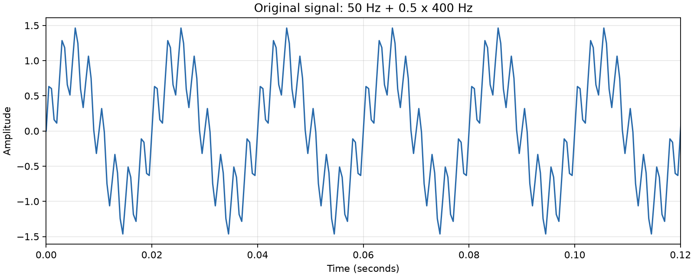
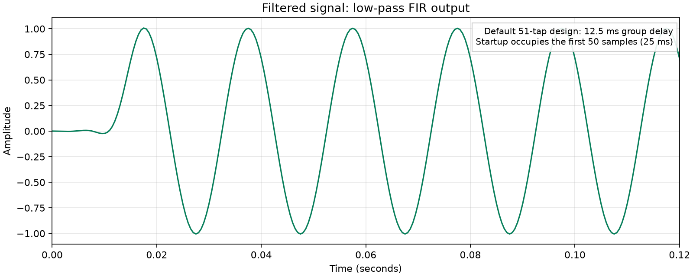
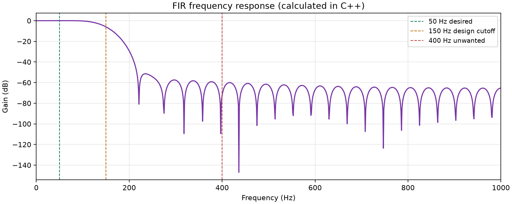

# Real-Time FIR Digital Filter and Signal Processing Engine

A small C++17 DSP project that separates a 50 Hz signal from an unwanted 400 Hz tone using a 51-tap low-pass FIR filter. It implements coefficient design, convolution, a stateful circular buffer, signal analysis, benchmarking, and CSV export from scratch.

This is a **desktop simulation with firmware-oriented techniques**. It does not run on a microcontroller or prove hard real-time deadlines. The sample processing method has fixed work for a chosen tap count and performs no memory allocation, making it a useful starting point for embedded DSP.

## What the program demonstrates

| Parameter | Default |
| --- | --- |
| Sampling frequency, `Fs` | 2000 Hz |
| Input length | 2000 samples, or 1 second |
| Desired component | 50 Hz, amplitude 1.0 |
| Unwanted component | 400 Hz, amplitude 0.5 |
| Low-pass design cutoff | 150 Hz |
| Filter length | 51 taps |
| Window | Hamming |
| Arithmetic | `double` |

The generated signal is:

```text
x[n] = sin(2*pi*50*n/Fs) + 0.5*sin(2*pi*400*n/Fs)
```

The application reports both tones' input/output amplitudes, measured gain in dB, the gain predicted by the designed coefficients, agreement with a reference implementation, and measured processing performance. Python is optional; all DSP and numerical measurements happen in C++.

## Build and run on Windows 11

Install MinGW-w64 GCC with C++17 support and CMake. Add their executable directories to `PATH`, and open PowerShell in this project directory. VS Code is a convenient editor but is not required by the build.

```powershell
g++ --version
cmake --version
cmake -S . -B build -G "MinGW Makefiles" -DCMAKE_BUILD_TYPE=Release
cmake --build build
ctest --test-dir build --output-on-failure
.\build\fir_engine.exe
```

Run the executable from the project root so its relative `results/` directory is created here. Use a fresh build directory if a previous CMake configuration selected another compiler or generator.

The optional first argument selects a different output directory, for example `.\build\fir_engine.exe results-demo`. Use `.\build\fir_engine.exe --help` for usage.

Optional plots require Python 3 and matplotlib:

```powershell
python -m pip install matplotlib
python .\scripts\plot.py
```

The script reads CSV files from `results/` and saves PNGs without opening windows. To select the folder explicitly or also show the figures:

```powershell
python .\scripts\plot.py --results results
python .\scripts\plot.py --results results --show
```

No NumPy, SciPy, third-party DSP library, or built-in FIR function is used by the engine.

## Read the project in one hour

| Time | Read and do |
| --- | --- |
| 0-10 minutes | Build, run, inspect the numerical summary and plots. |
| 10-25 minutes | Read `fir_filter.h` and `fir_filter.cpp`; trace the three-tap example below. |
| 25-35 minutes | Read `filter_design.cpp`; connect sinc, Hamming window, and normalization. |
| 35-45 minutes | Read `signal_generator.cpp` and `main.cpp`; follow measurement and export. |
| 45-55 minutes | Run tests; review benchmarking assumptions and limitations. |
| 55-60 minutes | Rehearse the short explanation and selected Q&A in [INTERVIEW_PREP.md](INTERVIEW_PREP.md). |

## Architecture

```text
configure Fs, tones, cutoff, and tap count
                  |
          generateSignal()
                  |
          designLowPass()
                  |
       +----------+-----------+
       |                      |
 referenceFIR()       FIRFilter::processBlock()
       |                      |
       +-- compare outputs ---+
                  |
   estimateAmplitude() + frequencyResponse()
                  |
      benchmark and export CSV files
                  |
   optional Python plotting of exported data
```

| File | Responsibility |
| --- | --- |
| `include/fir_filter.h`, `src/fir_filter.cpp` | `dsp::FIRFilter`, persistent history, block processing, reset, and direct-convolution reference. |
| `include/filter_design.h`, `src/filter_design.cpp` | Hamming-windowed low-pass design and direct frequency-response calculation. |
| `include/signal_generator.h`, `src/signal_generator.cpp` | Configurable sine-tone generation and sine/cosine amplitude estimation. |
| `src/main.cpp` | Demo settings, analysis, benchmark, readable output, and CSV export. |
| `tests/test_fir.cpp` | Automated numerical and state-management checks. |
| `scripts/plot.py` | Plot CSV data using matplotlib. |
| `CMakeLists.txt` | Build the engine and register tests with CTest. |
| `INTERVIEW_PREP.md` | Project walkthrough, DSP fundamentals, embedded concepts, and 20 practice answers. |

There are no hardware drivers, operating-system tasks, GUI components, or FFT modules. Change the demo settings in `main.cpp`; the reusable C++ interfaces accept other valid sampling rates, tones, lengths, and cutoffs.

Signal generation requires a positive finite sampling rate, a nonzero sample count, and at least one tone. Each tone needs a finite frequency strictly between zero and Nyquist and a finite nonnegative amplitude. Invalid configurations throw `std::invalid_argument`. The FIR constructor requires nonempty finite coefficients. The sample-processing path assumes finite incoming samples; it performs no per-sample validation or allocation.

## FIR filtering from scratch

An FIR filter produces a weighted sum of the present sample and a finite number of past samples:

```text
y[n] = sum(k = 0 ... M-1) h[k] * x[n-k]
```

`x` is the input, `y` is the output, `h` holds the coefficients, and `M` is the number of taps. A tap is one coefficient and its associated delayed sample. Before the first input, unavailable samples are treated as zero.

The class interface is intentionally small:

```cpp
dsp::FIRFilter filter(coefficients);
double output = filter.processSample(input); // No allocation; noexcept.
auto block = filter.processBlock(inputBlock); // Allocates the returned vector.
filter.reset();                              // Clear history; keep coefficients.
const auto& taps = filter.coefficients();
```

`processBlock()` calls the same sample processing path and retains history for the next block. Calling it twice on consecutive blocks is equivalent to filtering their concatenation once. Call `reset()` only when starting an independent signal or explicitly clearing the old history.

### Why a circular buffer?

The filter owns a zero-initialized `std::vector<double>` of `M` history entries. Its size stays fixed after construction. A write index marks where the next input goes. Each input overwrites the oldest entry, and coefficient `h[0]` multiplies the newly written sample. The read index moves backward, wrapping to `M-1` when it passes zero. After filtering, the write index advances and wraps to zero.

For three taps, the following table shows **physical vector order**, not chronological order:

| Input | Written index | History after writing | Samples read newest first | Next write index |
| --- | --- | --- | --- | --- |
| Initial state | -- | `[0, 0, 0]` | -- | 0 |
| 1 | 0 | `[1, 0, 0]` | `[1, 0, 0]` | 1 |
| 2 | 1 | `[1, 2, 0]` | `[2, 1, 0]` | 2 |
| 3 | 2 | `[1, 2, 3]` | `[3, 2, 1]` | 0 |
| 4 | 0 | `[4, 2, 3]` | `[4, 3, 2]` | 1 |

With coefficients `[0.25, 0.5, 0.25]`, the outputs are `[0.25, 1.0, 2.0, 3.0]`. No full history shift is needed. Conditional wraparound makes the indexing explicit; a carefully written modulo operation is another option.

### Reference versus circular-buffer implementation

| Property | Direct reference | Circular-buffer filter |
| --- | --- | --- |
| Access to past input | Index an existing input vector; skip negative indices. | Read persistent circular history. |
| Intended use | Clear correctness baseline for a complete signal. | Incoming samples and consecutive blocks. |
| Initial conditions | Implicit zero padding. | Zero-initialized history. |
| Time | `O(N*M)` for `N` samples. | `O(M)` per sample; `O(N*M)` per block. |
| Storage | Input/output arrays plus coefficients: `O(N+M)`. | History plus coefficients: `O(M)`; a returned block adds `O(N)`. |
| Allocation | Allocates an output vector for each reference call. | None in `processSample()`; `processBlock()` allocates output. |

Both compute the same convolution with the same coefficient order and zero initial state. A circular buffer improves streaming storage and avoids shifting; it does not change the convolution's arithmetic complexity. A direct reference can be competitive or faster on a desktop because of contiguous memory access. Measured timings decide the comparison.

`std::vector` owns its memory through RAII. There are no raw owning pointers and no manual `new`/`delete`. Constructor and block allocations still exist outside the allocation-free sample path.

## Designing the coefficients

`designLowPass(Fs, cutoff, taps)` requires finite positive `Fs`, finite `0 < cutoff < Fs/2`, and an odd tap count of at least 3. The general FIR class can also accept a one-tap identity filter; that is separate from the low-pass designer's requirements.

Let `alpha = (M-1)/2` and `fc = cutoff/Fs`, where `fc` is in cycles per sample. The ideal low-pass response is infinitely long. We keep `M` samples:

```text
ideal[n] = sin(2*pi*fc*(n-alpha)) / (pi*(n-alpha)), n != alpha
ideal[alpha] = 2*fc
```

Apply a Hamming window and normalize:

```text
w[n] = 0.54 - 0.46*cos(2*pi*n/(M-1))
raw[n] = ideal[n] * w[n]
h[n] = raw[n] / sum(raw)
```

The center formula avoids division by zero. The Hamming window softens the finite impulse response's endpoints, reducing frequency-response sidelobes compared with abruptly truncating the sinc. This trades a wider transition for lower sidelobes. Dividing by the coefficient sum gives unity gain at DC: `H(0) = sum(h) = 1` within floating-point precision.

The cutoff separates the desired low-frequency region from the rejected high-frequency region in the design. A finite filter has a transition band, so tones near 150 Hz are only partly passed. **The selected cutoff is not a promise of exactly -3 dB gain.** Inspect the calculated frequency response to determine its actual gain there.

Increasing taps generally narrows the transition for the same window and sampling frequency. It also increases computation, memory, and delay. Window choice affects sidelobes and transition width; more taps do not make every response property improve independently.

### Phase and delay

The designed coefficients are symmetric: `h[k] = h[M-1-k]`. An odd-length symmetric FIR has linear phase, so frequencies in a passband experience the same time delay. Its group delay is:

```text
delay_samples = (M-1)/2 = 25 samples
delay_seconds = 25/2000 = 0.0125 seconds = 12.5 ms
```

The output wave appears shifted in time. This delay is distinct from how long the CPU takes to calculate one sample. It is also distinct from the initial transient while the zero history fills. Phase is undefined at exact response zeros, so a simple linear-phase description applies away from those zeros.

## Measuring the result correctly

For a known tone frequency `f`, the program computes sine and cosine correlations on a steady segment:

```text
S = (2/L) * sum(x[n] * sin(2*pi*f*n/Fs))
C = (2/L) * sum(x[n] * cos(2*pi*f*n/Fs))
amplitude = sqrt(S*S + C*C)
gain_dB = 20*log10(output_amplitude / input_amplitude)
```

The amplitude magnitude accounts for phase delay; using only the sine correlation could incorrectly report attenuation caused by the delay. A negative dB result means attenuation. The same formula is applied separately to both tones.

The default analysis uses samples **80 through 1999**, or 1920 samples. This excludes the first `M-1 = 50` startup samples and contains exactly 48 cycles of 50 Hz and 384 cycles of 400 Hz. Over this segment, the test tones are orthogonal, so they do not contaminate one another's estimated amplitudes. `estimateAmplitude()` requires at least one whole cycle at the queried frequency and rejects a noncoherent query window. The caller must also ensure other tones are orthogonal to that query, as these default tones are. Arbitrary other tones or an unknown spectrum would need more careful spectral analysis.

For an independent prediction, the engine directly sums the complex response:

```text
H(f) = sum(k = 0 ... M-1) h[k] * exp(-j*2*pi*f*k/Fs)
expected_gain_dB = 20*log10(abs(H(f)))
```

The measured steady-state amplitude ratio should agree with `abs(H(f))` within numerical tolerance. The full response is evaluated from DC to Nyquist, `Fs/2 = 1000 Hz`, and exported by C++.

## Actual run results

Verified locally on Windows with MinGW-w64 GCC 16.1, a CMake Release build, and 8-byte `double` values:

| Tone | Input amplitude | Output amplitude | Measured gain | Predicted gain |
| --- | --- | --- | --- | --- |
| 50 Hz | 1.000000000 | 1.004962206 | +0.042995 dB | +0.042995 dB |
| 400 Hz | 0.500000000 | 0.000122890 | -72.189077 dB | -72.189077 dB |

The 50 Hz tone has about 0.5% amplitude increase from the finite filter's passband response. The 400 Hz tone is strongly suppressed. The measured and predicted gains agree to the printed precision. Gain at the 150 Hz design cutoff is **-6.007092 dB**, illustrating why the chosen cutoff must not be called an exact -3 dB point.

The reference and circular-buffer outputs had maximum absolute difference **0** in this run. CTest passed **1/1 registered test**, containing **10/10 test groups**. The four CSV files contained 2000, 2000, 51, and 1001 data rows respectively, with finite values. An independent check using Python's standard library verified exported frequency-response values at DC, both tones, the cutoff, and Nyquist, and reconstructed convolution with maximum absolute error about `1.11e-15`. All three PNG plots were generated with matplotlib.

Plot verification used a local environment under the ignored build directory. In this checkout, it can regenerate the figures immediately:

```powershell
.\build\plot-venv\Scripts\python.exe .\scripts\plot.py --results results
```

That environment is a local convenience; a fresh clone can use the normal Python installation commands above.

One captured benchmark used 200,000 samples per run, 12 measured runs per implementation, and one untimed warm-up for each:

| Implementation | Mean time/run | Min-max time/run | Average time/sample | Throughput |
| --- | --- | --- | --- | --- |
| Circular buffer | 6.461 ms | 6.413-6.557 ms | 32.307 ns | 30,953,483 samples/s |
| Reference | 6.367 ms | 6.314-6.504 ms | 31.833 ns | 31,413,900 samples/s |

The reference was slightly faster in this run. The circular implementation's benefits here are persistent streaming state, bounded history storage, and an allocation-free sample path. The logical filter payload was 816 bytes: 408 for history and 408 for coefficients. Each benchmark input or output block held 1,600,000 bytes separately.

Timings depend on the compiler, build settings, machine, and background activity. Read the live output for your machine and see the allocation differences below before comparing implementations.

## Output files and plots

| File in `results/` | Columns |
| --- | --- |
| `input_signal.csv` | `sample,time_seconds,amplitude` |
| `filtered_signal.csv` | `sample,time_seconds,amplitude` |
| `filter_coefficients.csv` | `tap,coefficient` |
| `filter_response.csv` | `frequency_hz,magnitude,gain_db` |

These images are generated from the application's exported data by `scripts/plot.py`:







Run the application and plotting script to regenerate them after changing any design parameters. The plots visualize C++ output; Python does not design the filter, apply convolution, or calculate its frequency response.

## Tests

```powershell
ctest --test-dir build --output-on-failure
```

Tests cover identity filtering, zero input, impulse response, agreement between implementations, state retained across blocks, reset, invalid parameters, coefficient symmetry, unity DC gain, and preservation/attenuation of the selected tones. Comparisons use floating-point tolerances, since decimal fractions and trigonometric calculations are not generally exact in binary arithmetic.

## Benchmark methodology

The benchmark uses `std::chrono::steady_clock` around real filtering work on 200,000 samples, with one untimed warm-up and 12 measured runs per implementation. It reports mean/min/max total time per run, average time per sample, throughput, and an observable checksum. Every output contributes to a checksum after timing. Resetting history before timing ensures each circular run starts with the same conditions.

The circular-buffer timing writes into an output vector allocated before the timed region; filter construction and reset are excluded. The reference implementation returns a newly allocated vector, so its timing includes output allocation and initialization but excludes vector destruction. Treat these as measurements of the documented call paths, not a pure CPU-only comparison with identical allocation costs. Input generation, checksums, and CSV/plot work are outside the filtering benchmark.

```text
total_samples = input_length * iterations
time_per_sample = measured_seconds / total_samples
throughput = total_samples / measured_seconds
```

Approximate owned filter storage is `(coefficient_count + history_count) * sizeof(double)`, excluding vector objects, allocator bookkeeping, capacity slack, input arrays, and output arrays. For 51 taps and 8-byte doubles this payload is `2 * 51 * 8 = 816` bytes. This is an estimate of filter state, not total process RAM. The reference uses an existing input and a full output; its working data scales with signal length.

At 2000 samples per second, the sample interval is 500 microseconds. Comparing average processing time with that interval indicates average desktop throughput headroom. It does not establish worst-case latency, interrupt behavior, scheduling guarantees, or a hard real-time deadline. Release builds are appropriate for performance comparison; absolute timings vary between runs.

## Relevance to cellular modem PHY work

FIR filters appear in channel selection, pulse shaping, matched filtering, and sample-rate conversion in communication systems. This project practices the underlying ideas: convolution, frequency response, phase delay, sampled data, persistent state, numerical verification, and measured CPU/memory costs.

The generated signal is a real-valued two-tone demonstration. It is not a cellular modem, does not process an actual radio waveform, and does not implement a cellular standard. The relevant engineering habits transfer to a PHY team: make assumptions explicit, verify the math, keep the processing path predictable, and measure implementation costs.

## Limitations and sensible next steps

- The filter uses floating-point `double` arithmetic and a single processing thread. A smaller MCU may benefit from `float` or carefully scaled fixed-point arithmetic after measuring accuracy and target performance.
- There is no live ADC acquisition, DMA, interrupt handling, or hardware timing measurement. A future STM32 port could feed the same sample algorithm from completed DMA blocks.
- The simple amplitude estimator assumes known coherent tones. Other signals may need a different measurement window or spectral method.
- Coefficient symmetry could reduce multiplications by pairing samples, and SIMD may improve desktop throughput. Both add implementation details and should be considered only after profiling.
- A target port must measure worst-case execution time, overrun behavior, memory use, and end-to-end latency on real hardware.

## A 2-3 minute demonstration

1. Show the default settings and run `.\build\fir_engine.exe`.
2. Point out agreement with the reference, near-unity 50 Hz gain, and negative 400 Hz gain. Use the actual values printed on your run.
3. Show the original/filtered plots and frequency response. Explain the 25-sample delay.
4. Open `processSample()` and identify one history write, the convolution loop, and wraparound indexing. Explain that this path does not allocate.
5. Show passing CTest output and one measured benchmark line. State that this is desktop throughput evidence, with hardware timing left for a future port.
